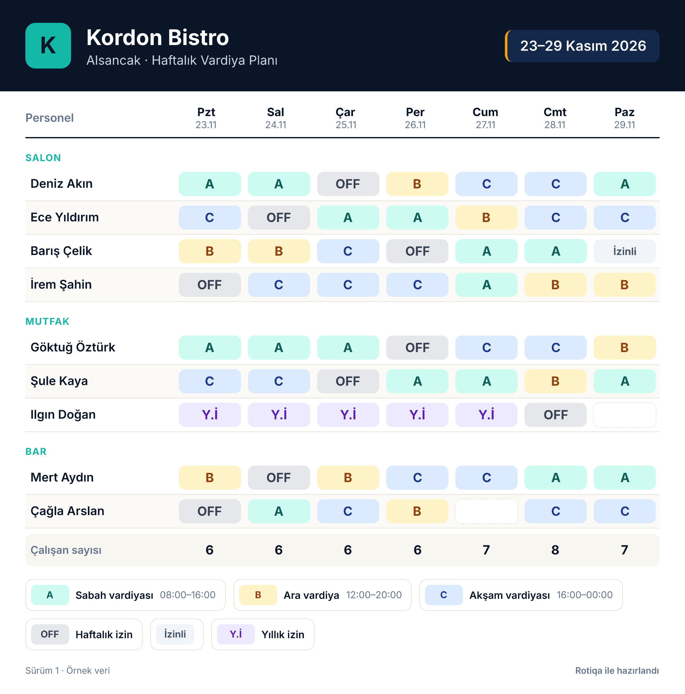

# Rotiqa

**Plan your team, save your time.** — *Ekibini planla, zamanını kazan.*

Rotiqa is a shift scheduling, timesheet and staff management SaaS for businesses that run on shifts: restaurants, cafés, hotels, retail stores and clinics. It replaces the weekly "Excel → screenshot → WhatsApp group" routine with a mobile-first planner that produces a clean, shareable schedule image in a few taps.

> **Status:** early development (phase F0 — foundation). Not production-ready yet. See the [roadmap](#roadmap).

<p align="center">
  
  <br>
  <sub>Schedule image rendered server-side from data with Satori + resvg. Business and staff are fictional.</sub>
</p>

## Features

Planned for the first release (✅ = available today):

- **Weekly shift planner** — Excel-like grid, Monday → Sunday, tap to assign, paint mode, copy previous week, autosave, undo, daily headcounts, department grouping, draft vs. published plans.
- **Configurable shift codes** — each business defines its own codes, hours and colors. Starter set: `A`, `B`, `C`, `OFF`, `R`, `Y.İ`.
- **Staff management** — departments, ordering, active/archived staff, per-location staff. Archiving never rewrites past schedules.
- ✅ **WhatsApp-ready schedule image (prototype)** — a high-resolution PNG rendered from data (not a screenshot), including every employee, the week range, color-coded shifts, a legend and daily headcounts. Medical leave (`R`) is shown as a generic *"İzinli"* by default to avoid exposing health data.
- **Publication history** — every shared version is kept.
- **Multi-tenant** — organizations, locations, `OWNER` / `MANAGER` roles with per-location permissions, strict data isolation.
- **Timesheets (later)** — clock-in/out records, planned vs. actual hours, overtime, reports and exports.
- **Live demo** — a sandboxed demo business per visitor, on a separate database.

## Tech stack

| Area | Choice |
| --- | --- |
| App | [Nuxt 4](https://nuxt.com) (Vue 3, TypeScript strict), single modular monolith |
| UI | Tailwind CSS v4, Inter (self-hosted), Pinia |
| API | Nuxt server routes (Nitro), Zod validation |
| Database | PostgreSQL 18, Prisma 7 (driver adapter `@prisma/adapter-pg`) |
| Auth | Better Auth *(phase F1)* |
| Images | Satori (layout → SVG) + resvg (SVG → PNG) |
| Quality | ESLint (flat config), `vue-tsc`, Vitest, Playwright, GitHub Actions |
| Tooling | pnpm, Docker Compose for local Postgres |

## Architecture

One Nuxt application, organized as a **modular monolith**. Business logic lives in framework-agnostic modules; API handlers stay thin (parse → authorize → call module → respond).

```
app/                     Vue front end (pages, components, design tokens)
  assets/css/main.css    Design tokens (Tailwind @theme)
  components/ui/         Base UI components (UiButton, UiShiftCell, …)
server/
  api/                   HTTP handlers only
  modules/               Business logic per domain
    schedule-image/      Schedule → PNG rendering (pure, unit-tested)
  utils/db.ts            Prisma client factory
  assets/fonts/          Fonts bundled for server-side rendering (SIL OFL)
shared/                  Types and pure helpers used by both app and server
prisma/                  Schema and migrations
tests/
  unit/                  Pure TS tests (Node)
  nuxt/                  Component tests (Nuxt runtime)
  e2e/                   Playwright, mobile + desktop
```

Key decisions:

- **Tenant isolation in two layers.** Every request is authorized against organization and location membership in the application layer, and PostgreSQL Row Level Security acts as a second line of defense. The app connects with a non-owner role so RLS cannot be bypassed.
- **History is immutable.** Shift assignments snapshot the code's hours and label at assignment time, so editing a shift code later never rewrites past weeks.
- **Demo is physically separate.** The public demo runs on its own database (`DEMO_DATABASE_URL`), never on customer data.
- **Images from data, not screenshots.** The share image is rendered server-side, so it always contains the full roster regardless of screen size.
- **Timesheets are designed for, not built yet.** The schedule model keeps planned hours per assignment so actual hours can be compared later.

## Getting started

Requirements: Node.js ≥ 24.15, pnpm 12, Docker.

```bash
pnpm install          # also runs `nuxt prepare` and `prisma generate`
cp .env.example .env
pnpm db:up            # Postgres 18 on localhost:5436 (databases: rotiqa, rotiqa_demo, rotiqa_test)
pnpm dev              # http://localhost:3000
```

Useful pages in development:

- `/design-system` — color tokens, buttons, shift cells and the rendered schedule image
- `/api/dev/schedule-image` — sample schedule PNG (development only)
- `/api/health` — app + database health

## Scripts

| Command | Description |
| --- | --- |
| `pnpm dev` | Start the dev server |
| `pnpm lint` / `pnpm lint:fix` | ESLint |
| `pnpm typecheck` | `vue-tsc` via `nuxt typecheck` |
| `pnpm test` | Unit + component tests (Vitest) |
| `pnpm build` | Production build |
| `pnpm test:e2e` | Playwright against the production build (run `pnpm build` first; needs the database) |
| `pnpm check` | lint + typecheck + test + build |
| `pnpm db:up` / `pnpm db:down` | Start / stop local Postgres |
| `pnpm db:migrate` | Create and apply a migration |

## Screenshots

More screenshots will be added as the planner UI lands (phase F2).

## Roadmap

- [x] **F0 — Foundation:** Nuxt 4, TypeScript, Tailwind, Prisma, Docker Postgres, ESLint, tests, CI, design tokens, PNG rendering spike
- [ ] **F1 — Auth & tenancy:** sign-in, organizations, locations, roles, invitations, staff model, RLS isolation tests
- [ ] **F2 — Weekly planner:** mobile grid, assignment, paint mode, autosave, copy week, undo
- [ ] **F3 — Staff & shift settings:** staff, departments, shift codes, history
- [ ] **F4 — Publish & share:** PNG generation, publication versions, WhatsApp share, PWA
- [ ] **F5 — Pilot** with a real business
- [ ] **P — Timesheets:** manual entries, PDF import, planned vs. actual, reports
- [ ] **F6 — Landing page & live demo**

## Privacy

This repository contains **fictional data only**. No real employee names, business data or secrets are committed. Medical-leave codes are masked in shared images by default.

## License

To be decided. Until a license is added, all rights are reserved.

Fonts in `server/assets/fonts` are [Inter](https://github.com/rsms/inter), licensed under the SIL Open Font License 1.1 (see `server/assets/fonts/OFL.txt`).
